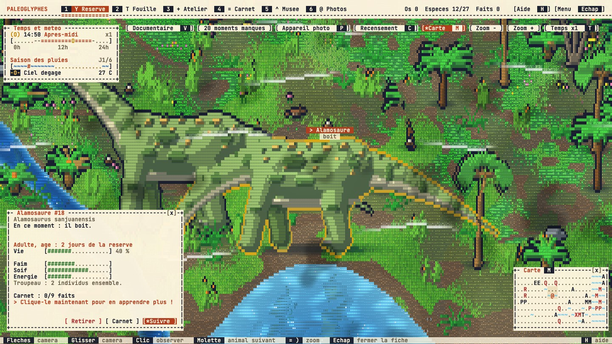
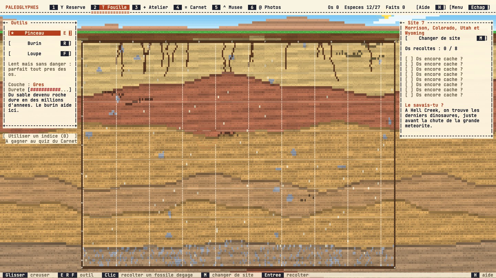
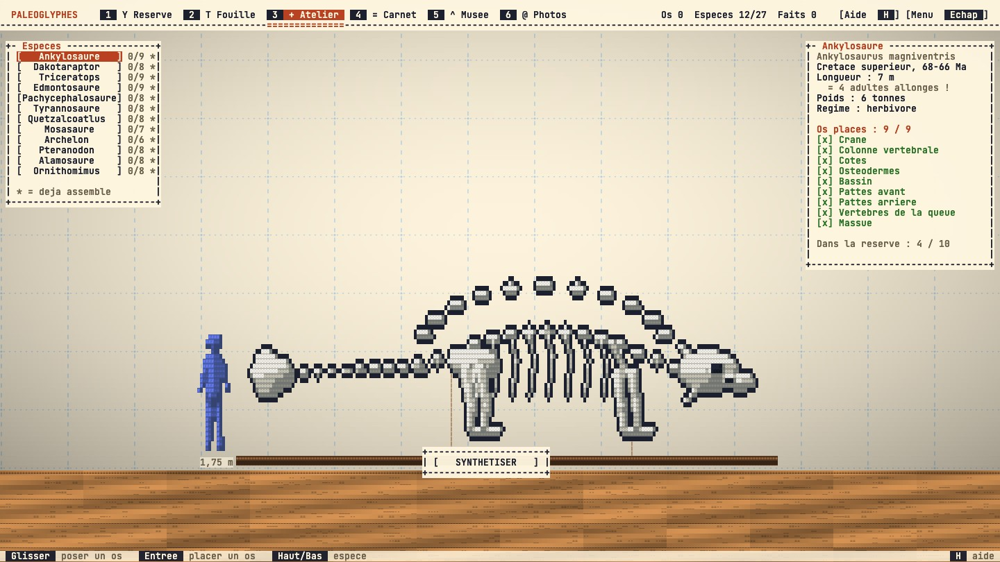
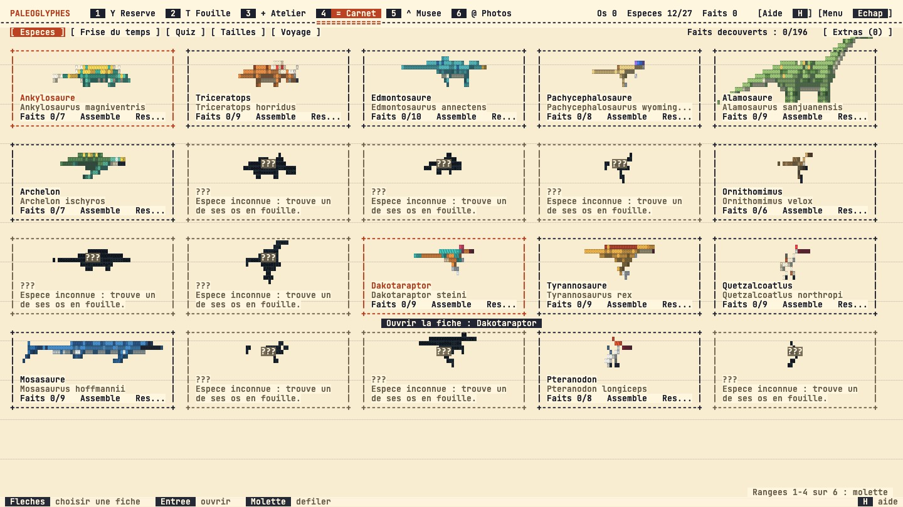
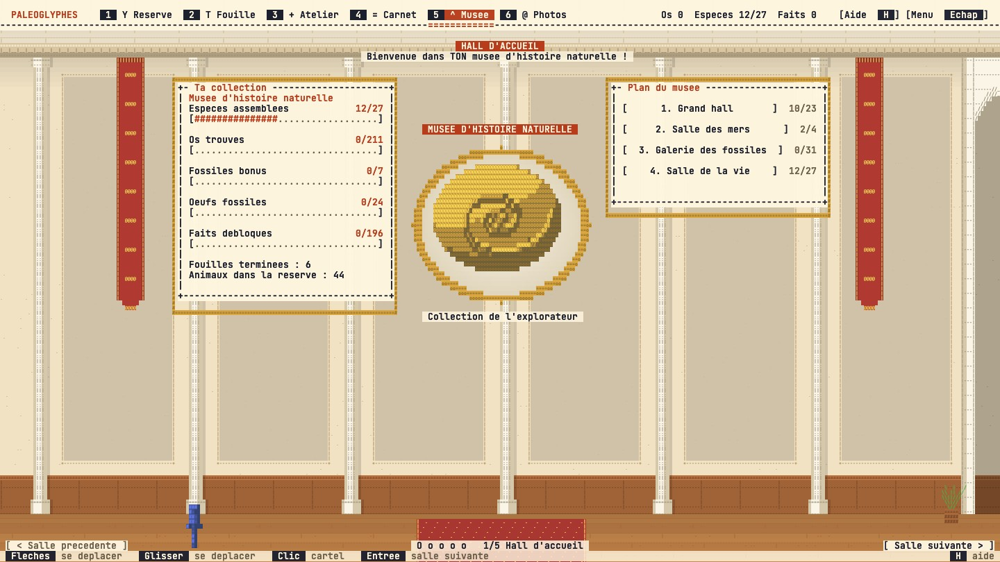

# Paléoglyphes

Jeu éducatif sur les dinosaures, entièrement rendu en caractères ASCII (32 à 126), chaque caractère jouant le rôle d'un pixel.
Cadre : Hell Creek, fin du Crétacé, il y a 66 millions d'années (inspiré de faits réels).



1. **Fouille** : dégage des os dans une falaise stratifiée (pinceau, burin, loupe).
2. **Atelier** : assemble les squelettes puis synthétise les dinosaures.
3. **Réserve** : caméra libre sur un écosystème vivant (troupeaux, chasse, défense, charognards).
4. **Carnet** : clique un animal pendant qu'il agit pour débloquer des faits.

Deux styles au choix (Échap) : *dark fantasy* et *cartoon*.

**Jouer en ligne : https://sh1v4x.github.io/paleoglyphes/**

## Aperçu

| Fouille | Atelier |
| :---: | :---: |
|  |  |
| **Carnet** | **Musée** |
|  |  |

## Lancer

```bash
npm install
npm run dev   # http://localhost:3107
```

## Outils

```bash
npx tsx scripts/preview-sprite.ts trex attack 0.5   # aperçu d'un modèle dans le terminal
```

## Licence

MIT, voir [LICENSE](LICENSE).
